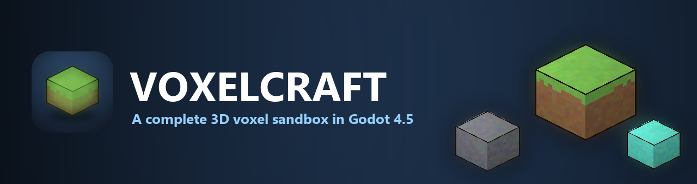
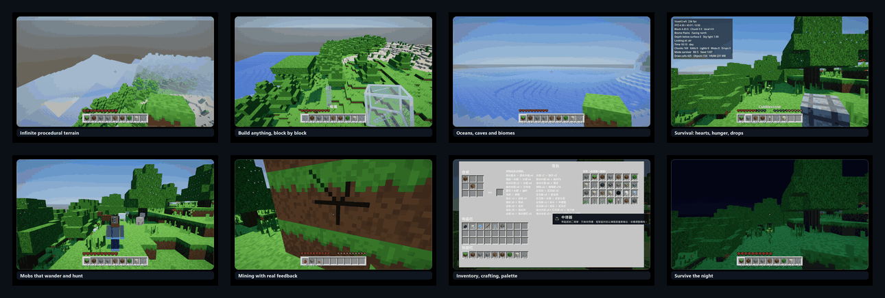

# VOXELCRAFT



A complete 3D voxel sandbox in the spirit of **Minecraft**, built with **Godot 4.5**
(Forward+ renderer). Dig, build, explore infinite procedural terrain, survive the
night, and craft your way from a bare fist to a stack of torches.

## Screenshots



Full-resolution promo frames are in `assets/screenshots/` (English and Chinese). The
raw output of the verification capture pass is in `previews/`.


## Run it

The engine is **not** bundled — this is a source repository. Install **Godot 4.5.x**
(the standard build, which ships the Forward+ renderer) from
<https://godotengine.org/download/windows/>, then give `run_game.bat` a way to find it,
by any one of:

* renaming the downloaded `.exe` to `Godot.exe` and dropping it beside `run_game.bat`;
* putting it in a `godot\` folder beside `run_game.bat`;
* setting the `GODOT_EXE` environment variable to its full path.

Then double-click **`run_game.bat`** (starts Godot 4.5.1 with this project).
To open the editor instead, double-click **`open_editor.bat`**.

## Build a Windows executable

Double-click **`build_exe.bat`**. It exports `build\VoxelCraft.exe` — one self-contained
file, with the game data packed inside it, so it can be copied anywhere and just run. No
DLLs, no loose `.pck`, no engine install needed on the target machine.

The preset lives in `export_presets.cfg`, which is what the script reads; the export needs
the Godot 4.5.1 **export templates** installed (Godot's *Editor → Manage Export Templates*,
or the `4.5.1.stable` folder under `%APPDATA%\Godot\export_templates`). Only the release
template is used, since that is all a release build needs.

> The one thing to watch if you edit `export_presets.cfg` by hand: it must be UTF-8
> **without a byte-order mark**. Godot's config parser does not skip a BOM, and a file
> that starts with one loses `[preset.0]` as a section — the export then fails with
> *"Invalid export preset name"* and an empty list of presets, which reads like a missing
> preset rather than a file-encoding problem. PowerShell's `Set-Content` adds a BOM.

## Controls

| Key | Action |
| --- | --- |
| `W A S D` | Move |
| `Space` | Jump / swim up / fly up |
| `Shift` | Sneak (slower) / fly down / dive while swimming |
| `Ctrl` | Sprint — hold it, or double-tap `W`, just like Minecraft (with a FOV kick) |
| Mouse | Look |
| **Left mouse** | Hold to mine (the block visibly cracks as you dig) |
| **Right mouse** | Place the selected block, eat the selected food, flip a switch / press a button / aim a relay, or **hold** it to draw a bow |
| **Middle mouse** | Pick the block you are looking at |
| `1` … `9` / wheel | Select a hotbar slot |
| `E` | Inventory, crafting and the block palette |
| `L` | Advancements / progress screen |
| `Q` | Drop one item |
| `T` | Open the chat box |
| `/` | Open the chat box already in command mode |
| `` ` `` | Open the console (a terminal: bare commands work, no `/` needed) |
| Double-tap `Space` | Toggle flight (creative only) |
| `F5` | Cycle the camera: first person, third person (behind), second person (front) |
| `F3` | Debug overlay (position, chunk, biome, light, FPS, draw calls, drops) |
| `F12` | Save a screenshot to the user data folder |
| `Esc` | Pause / close the inventory / close the chat |

Moving the mouse out of the window — or taking the window out of focus at all — pauses the
game and brings the pause screen up, and it stays paused until you choose to resume. While
you are actually playing the cursor is held by the window, because that is what mouse-look
needs; the moment a menu opens it is released, so the cursor can be moved anywhere and the
game stops rather than carrying on behind the menu. In fullscreen the desktop will not let
the cursor off the screen, so there the trigger is clicking another window or `Alt-Tab`;
both are handled.

## Gameplay

**Two game modes**

* **Creative** — fly with a double-tap of `Space`, mine anything instantly, and
  take any block you like from the palette in the inventory. **Creative players
  take no damage at all** — falls, drowning, starvation and the void are all
  ignored, the way Minecraft does it. Only `/kill` can still end you.
* **Survival** — 10 hearts, fall damage, drowning, mining times based on block
  hardness, a hunger bar you have to keep topped up, and blocks that drop items
  you actually have to walk over and collect.

You can switch between them mid-game with `/gamemode creative` — no restart.

**Dropped items**

Break a block and it pops out as a real entity: a small spinning cube for blocks,
or a flat icon billboard for pure items. Drops fall, settle on the ground, bob,
and merge with identical stacks lying nearby. Walk over one and it flies into your
bag with a *pop*; a full inventory leaves it on the floor instead of eating it.
Clearing a stack of leaves sometimes also coughs up an apple.

**Hunger & food**

A ten-drumstick bar sits beside the hearts (survival only — creative has none,
like Minecraft). The bar is mirrored, so it empties from the left and a half
drumstick fills from the right, opposite to a half heart. Walking, sprinting and
jumping burn food, sprinting is locked out below three drumsticks, health only
regenerates when you are nearly full, and an empty bar slowly starves you. Apples
fall out of leaves and bread is in the creative palette; hold one and right-click
to eat.

**Husbandry**

Right-click an animal while holding the food it eats and it takes it: wheat for cows
and sheep, a carrot or a potato for a pig, seeds for a chicken. Feed two of the same
kind and they pair up and produce a baby, which is born small and grows up over a
minute. Shears — two iron in a diagonal — cut a sheep's fleece for one to three wool
without killing it, and the wool grows back after a while.

**Root crops**

Carrots and potatoes join wheat. Take one from tall grass, a village or a drop, then
plant it on farmland the same way: right-click the tilled soil with it in hand. They
ripen through four stages like wheat, and harvesting a ripe one drops the vegetable
and leaves the soil ready to plant again. A potato bakes in a furnace; so does a fish.

**Fishing**

The rod is three sticks in a diagonal. Right-click open water to cast the bobber, wait
for a bite, then right-click again to reel in a raw fish. Reeling before the bite just
brings the line back, and the line snaps if you walk too far away.

**Wolves**

Wolves live in the woods. Feed one a bone and it may become yours; a tamed wolf follows
you, attacks the hostile mobs it finds, and sits or stands up when you right-click it
with an empty hand. Feed it meat to heal it.

**Explosives**

Gravel sometimes hides a shard of flint, and flint plus an iron ingot makes flint and
steel. Right-click a block of TNT to light its fuse; it burns for a couple of seconds
and then goes off in the same blast a creeper makes. A dispenser, handed an arrow,
launches it along your aim.

**Archery**

A bow is three sticks and three string. Hold right-click to draw it — a full draw takes a
second — and let go to loose an arrow. The longer the draw, the faster and harder the shot:
a flick of the button does nothing but click. Arrows come out of the quiver wherever they
are in your bag, and a skeleton or a dispenser can hand you more.

**Repair**

An anvil is three blocks of iron over four ingots. Right-click one holding a worn tool or
piece of armour and it is bought back to full durability for experience levels — the price
rises with how far it has worn down, so topping up a nearly-new pick costs a level or two
and a nearly-broken one costs a dozen. There is no panel: the price is a toast and the deal
happens on the click.

**Potions**

Four potions are brewed in the crafting grid from a pane of glass and one reagent: a
feather for Swiftness, a slimeball for Regeneration, a bone for Strength and glowstone
for Night Vision. A **brewing stand** — a torch over three cobblestone — does the same
trade without a table: right-click it holding the reagent. Each is drunk for a real
effect — a faster walk, steady healing,
harder hits, or a brightened world. Add gunpowder and it becomes a splash potion,
thrown rather than drunk, that affects everything near where it lands.

**Hopper**

A hopper is five iron ingots round a chest. Put one under a chest and over another and it
carries items a step down the line on its own, one every four-tenths of a second: it fills
a matching stack before it takes an empty cell, and it pulls a furnace's finished output
into the chest below. Nothing has to power it.

**Observer & comparator**

The power set has two parts that sense rather than store. An **observer** watches the cell
it faces and pulses for a single tick whenever that block changes, so it turns a block
being placed or broken into a signal. A **comparator** reads the container it is pointed
away from and drives a level of 1..15 set by how many of its slots are filled, so a chest
that is half full can open a door and a full one can hold it open. Both are aimed with a
right-click, the way a relay is.

**Beacon**

Eight obsidian round a diamond make a beacon. Set it on a 3x3 of iron, gold or diamond
blocks and it turns on: everyone within sixteen blocks gets Regeneration while they stay
there. Take the base away and it is just a lamp — which it also is, since a beacon lights
its own room whether or not it is doing anything else.

**Vehicles**

A **minecart** is five iron ingots in a U; a **boat** is the same shape in planks; a
**rail** is six ingots round a stick, sixteen at a time. Right-click the ground with a cart
or a boat in hand and it goes down as a vehicle rather than a block. Right-click one to get
in, `Shift` to get out, and `W A S D` to steer: a cart rolls along at 7 blocks a second, and
11 on rails, coasting to a stop when nobody is pushing it; a boat floats on water and is
dragged by it. While you are riding, the vehicle is what moves and what collides, and the
camera rides with it.

**The Nether**

Build a doorway: a ring of obsidian with at least a two-wide, three-tall hole in it.
Obsidian is what a bucket of water poured on lava leaves behind, and a diamond pick is
what it takes to move a piece once it has set. Light the hole with flint and steel and the
doorway fills with the swirling portal — stand in it for a moment and it takes you through.

The nether is a dimension of its own, not a cave under the overworld: a solid body of
**netherrack** between a bedrock floor and a bedrock roof, carved through with big open
caverns and floored with a sea of **lava**. **Glowstone** hangs in clusters from the
ceiling, **soul sand** and **magma** lie across the low ground, and the rock is shot through
with **nether quartz ore** — the dimension's own reward for digging. The sky is a red haze
with no sun, no moon and no rain, and eight blocks walked here are one block of overworld
distance, so the two doors stay paired.

Everything on each side is kept apart: a chest in the nether and a chest at the same
coordinates in the overworld are different chests, and so are their wire, their fluid and
their facings. Travel back and forth as often as you like — the save keeps both dimensions
whole, and the side you saved on is the side you load back into.

**Advancements**

Sixty milestones track how far you have come, in the spirit of Minecraft's
advancements: break your first block, get wood, benchmark a crafting table, reach
the Stone Age, smelt iron, find a diamond, trade with a villager, enchant a tool,
draw your first copper wire. They are grouped into Getting Started, Mining, Building,
Husbandry, Adventure and Industry, and earning one slides a gold-bordered banner in
at the top of the screen with its icon, "Advancement Made!" and its name.

Two of them are counted goals rather than a single event — break 100 blocks to become
a Miner, place 200 to become an Architect — and two fire on a value rather than an
event: reaching experience level 10 is *Experienced*. The full list, with what each
one asks for and how many of the fifty-seven you have earned, is on the **Advancements**
screen, opened from the pause menu; earned rows are lit and the rest are dimmed rather
than hidden, so you can always see what there is left to aim for. Press `L` for it in
game, or read the tally with `/progress` (and manage it with `/advancement grant|revoke`).

The system is data, not code. Each milestone is one line naming a group, an icon (a
real item or block id, so the icon renderer draws it), a name, a description and the
event that earns it, and every trigger funnels through one `Advancements.trigger()`
call from a place that was already in the code — the block-break hook, the craft
handler, the item pickup, the furnace tick, the trade and enchant paths. Progress is
stored in the world's `level.json`, so it travels with the save.

**Mining feedback**

The block you are mining cracks progressively — five stages of generated veins
radiating from the middle of the face — and every hit throws a little burst of chips
tinted with that block's own average colour. Breaking it throws a bigger one.

The overlay uses its own cube rather than Godot's `BoxMesh`: `BoxMesh` cube-maps its
UVs into a 3×2 layout, so a texture drawn to fill one face arrives sliced to a third
of its width and shifted off centre, which reads as "the crack is not on the block I
am mining". `Blocks.make_overlay_cube()` maps every face to the full 0..1 square.

**Character & skins**

You are a proper Minecraft-style character, not a floating camera: six textured
boxes (head, torso, two arms, two legs) with a walk/idle/sneak/fly animation and a
head that aims where you look. `F5` cycles three cameras — first person, third
person behind, and **second person**, a camera in front looking back at you — with
a wall-aware pull-in so the camera never ends up buried in terrain.

The posing follows Minecraft's:

* the head aims where you look, up and down **and** left and right. The body eases
  toward the look instead of snapping to it, so a quick turn reads as the head
  leading and the shoulders following, and the neck is clamped at 75 degrees the
  way Minecraft's is;
* crouching tips the chest forward **over the hips** — which is why the torso is
  pivoted at the waist rather than the shoulders, or a crouch would push the hips
  out in front instead;
* mining swings the right arm **forward**, in every camera, and the block you are
  holding rides along in that hand. That arm is the only place a held block is drawn,
  in all three cameras: there used to be a second, camera-mounted arm and a floating
  block cube doing duty as "the first person hand", which became a duplicate the moment
  the body itself was drawn in first person, so it was removed rather than left to
  overlap;
* **first person draws the body, and its shadow.** The head and the chest come off, and
  the limbs stay. The head has to go because the camera rides at the eye line, 1.62 up,
  inside a skull that spans 1.32 to 1.76 — leave it on and you are looking at the inside
  of your own head. The chest has to go because its top and the tops of both arms form
  one flat, coplanar, same-coloured plane 0.88 wide and only 0.30 below the eye: from
  there it covers the bottom third of the screen the moment you look down more than about
  thirty degrees, which is most of the time you are mining or building, and it reads as a
  shutter over the ground rather than as a chest. Arms and legs stay, so looking down
  shows your own limbs on the ground — and, because the body is still *drawn* even when
  parts of it are skipped, it still casts a shadow. Hiding the whole body instead (which
  is what the game used to do) took the shadow with it, and an invisible node casts none;
* the head turns on the **neck**, not on the head box: that box's own origin sits at
  the crown, so rotating it there swings the whole skull around the top of the head.

The skin is generated the same way as everything else — a 64×64 texture painted in
code using the classic Minecraft unwrap, so faces, sleeves, hands, trousers and
shoes all land in the right place — with six presets (Steve, Alex, Ninja, Miner,
Gold, Slime) selectable in **Settings → Player → Skin**.

**Real Minecraft skins** work too: *Settings → Player → Load skin file…* takes any
64×64 PNG, the legacy 64×32 layout (upgraded on load by reflecting the right arm
and leg across the body plane, as the game itself does) or an HD multiple such as
128×128. The file is vetted before it is applied, so a bad pick leaves your current
skin alone, and `--skin=<path>` does the same from the command line.

**Animals**

Passive mobs wander the plains and forests: pigs, sheep, cows and chickens. Each is
a coloured box quadruped with a simple AI (wander, pause, turn away from you when you
get too close), gravity, voxel collision, leg animation and its own synthesised
voice. They spawn on grass within a few dozen blocks of you, and despawn when you
wander off — up to 14 at a time.

**Villages & trading**

Villages dot the land: a levelled terrace with a stone-brick well and four lamp posts at
its centre, cottages around it under flat slab roofs, a fenced wheat field or two, and
gravel paths joining them up. Each cottage is cobble-floored with log corner posts, plank
walls, a glass window on every side, a two-high doorway facing the plaza, and a torch, a
bed, a crafting table and a chest inside.

A village is placed on a coarse grid, one candidate per 112-block cell, and everything
about it — where it stands, how high its terrace sits, which way each door faces — is a
pure function of the cell and the world seed. That is what lets every chunk that touches a
village stamp the same blocks on its own, in any thread, with the parts that fall outside
the chunk simply dropped; there is no post-generation pass and no cross-chunk
coordination. Trees and plants are laid down first and the terrace is stamped over them,
so nothing grows through a cottage. Only about one cell in six carries a village, and the
cell grid keeps them far enough apart to be a place you come across rather than the
default ground.

**Villagers** live in them, not in the wild: the animal spawner never places one, and a
separate spawner keeps up to eight alive around whichever village is nearest the player.
A villager is a robed, big-nosed humanoid that (unlike the animals) does not run from you,
and right-clicking one opens a **trade**.

A village also keeps an **iron golem** or two on watch: a big pale humanoid that never
attacks you, never wanders off, and hits any hostile mob that comes near it for seven
damage a swing. It is worth a handful of iron ingots if you kill it, which is the only
honest source of iron that is not mining or smelting.

A **wandering trader** turns up on its own, rarely, wherever you are standing — one at a
time, never in a village. It trades in the things a village does not: a diamond for four
emeralds, slimeballs, gunpowder, cooked fish. It has no stall of its own and it does not
run away.

Each villager keeps one of four trades — Farmer, Butcher, Smith or Mason — chosen from
where it stands rather than from any saved state, so a village's shopkeepers are the same
every time without a byte of persistence. Every trade has two sides: the top offer buys
your goods for an **emerald** (wheat, raw beef, coal or cobblestone), and the bottom one
spends an emerald on finished goods (bread, cooked porkchop, iron ingots or stone bricks).
Trading takes what you have and hands over what you bought in one step; it will not take
payment it cannot pay you back for, and a trade you cannot afford is refused rather than
let you go into debt. Emeralds are the currency and there is no emerald ore — the only way
to get one is to trade for it.

**World**

* Infinite chunk-streamed terrain: continents, hills, mountains, oceans and beaches.
* Eight biomes — plains, forest, birch forest, desert, snowy tundra, mountains, beach,
  ocean — each with its own surface blocks (grass, sand, snow, stone, gravel) and
  vegetation.
* Oak and birch trees with proper canopies, tall grass, poppies and dandelions, cacti in
  the desert.
* Winding cave systems carved by noise, reaching from y = 58 down to y = -24, with
  ore veins in depth bands: coal and copper high up, iron and gold in the middle, and
  diamonds below y = -40. The bands are absolute, so "diamonds are deep" means the same
  thing in every column rather than being measured from whatever the surface happens to
  be doing.
* A 15-minute day/night cycle with a moving sun, moonlight, sky colours and fog that
  follows the time of day.
* Weather on its own clock: long clear spells, shorter rain and the odd thunderstorm,
  each lasting 35 to 120 seconds. Rain dims and desaturates the sky and drops a sheet of
  falling water around you; a thunderstorm adds lightning flashes on top. `/weather
  clear|rain|thunder` sets it at once.
* Water you can swim and drown in, with an underwater fog and colour shift. Hold
  `Space` to swim up and `Shift` to dive; at the surface `Space` becomes a real
  jump, strong enough to climb out onto a one-block shore.

**Building**

* 129 block ids — stone, grass, dirt, cobblestone, planks, logs, leaves, sand,
  sandstone, glass, bricks, stone bricks, glowstone, obsidian, snow, ice, cactus,
  torches, crafting tables, chests, doors, ladders, fences, glass panes, slabs, stairs,
  trapdoors, fence gates, signs, birch wood, beds, an enchanting table, an anvil, a
  brewing stand, a hopper, a beacon, a rail, farmland and the wheat / carrot / potato
  crops, sixteen wool colours and their carpets, TNT and a dispenser, four ore blocks,
  blocks of iron / gold / diamond, bedrock, lava, the whole power set below —
  including the observer and the comparator — and the nether's own set: netherrack,
  soul sand, nether bricks, magma and nether quartz ore, with the portal as the
  doorway they light into. (The count includes every crop stage and every open /
  closed state, since each is an id of its own.)
* Torches, glowstone, lit lamps and an extended piston are real light
  sources — a pool of point lights follows the nearest ones, so caves light up as
  you explore and a circuit lights its own room.
* Minecraft-style voxel lighting: ambient occlusion on every face corner plus a
  baked sky-light gradient that darkens with depth underground.
* Cross-shaped plants, alpha-cutout leaves and translucent water/glass/ice.
* The shapes that are not cubes are drawn as their real shapes, not as a cube wearing a
  texture: a slab is half height, a stair is an L, a trapdoor is a hatch, a fence is a post
  with rails, a fence gate is a gate panel that remembers which way you faced when you set
  it, and a door is a thin leaf. The icon in the palette is the same shape, so a trapdoor
  never shows up as a plain block.
* **A bed is two cells** — a foot and a head with the pillow at the head — placed together
  along the way you were facing, and taken apart together when either half is broken.
* The **ender pearl** is thrown rather than placed: right-click hurls it at whatever the
  crosshair is on and you arrive where it lands, one pearl poorer.
* Many carried items on top of the blocks — stick, coal, iron, gold, diamond, apple,
  bread, copper, a piston arm, carrot, potato, baked potato, shears, flint, flint and
  steel, a fishing rod, a bow, raw fish, cooked fish, and four potions (each with a splash
  form) — each with a generated isometric or flat icon, plus a dropped entity form for
  every one of them.

**Power (electricity)**

The power set is a small electrical system, named and drawn like one rather than
like Minecraft's redstone:

| Block | Role |
| --- | --- |
| **Switch** | A knife switch. Right-click to open or close the circuit. |
| **Button** | A momentary switch — springs back on its own after 1.5 s. |
| **Pressure plate** | A sensor. Live while something stands on it. |
| **Battery** | A cell: a permanent, always-on supply. |
| **Wire** | The conductor. Carries a level 0..15 and **drops 1 per block**, so a run dies out after 15 — resistive loss down a line. |
| **Inverter** | A NOT gate: its output is live while its input is dead, and dark when the input is driven. |
| **Signal relay** | A diode with a delay: signal passes one way only, re-driven at full strength after 0.2 s. Right-click to aim it. |
| **Lamp** | An indicator (an LED). Lights up when powered. |
| **Piston** | An actuator (a solenoid). Powered, it shoves the block in front one cell on and pulls it back when released. |
| **Observer** | An edge sensor: it watches the cell it faces and pulses for one tick whenever that block changes. Right-click to aim it. |
| **Comparator** | A reader: it drives a level of 1..15 set by how many slots the container behind it has filled, so a chest can be read rather than only switched. Right-click to aim it. |
| **Hopper** | A conveyor: one item every 0.4 s from the container above into the one below. Nothing powers it. |

Copper is the conductor: copper ore drops copper ingots, and one ingot draws four
wire. A wire block drops itself, so a run can be picked up and re-laid.

A solid block next to a live wire becomes **charged**, which is how a lamp or an
inverter placed on top of it gets its supply — the role a copper pad plays on a real
board. Charged blocks deliberately do not carry the signal any further, which is
what stops a circuit shorting through the ground. The level of a wire is its own
signal, so a wire never "reads" its neighbour back at full strength.

The solver runs a fixed-point iteration (capped at 8 passes) so a feedback loop
blinks instead of hanging the game, and it only does work on the frames a circuit
block actually changed — a quiet frame is one dictionary lookup. Supplies drive
their own cell first, then wires decay, then components act, and the pass repeats
only while some component's state changed. A switch, lamp, wire and relay keep one
block id with two faces, so flipping a switch does not turn it into a different
block; the lit face lives in a tile override that is baked into the chunk payload
before it is handed to a worker thread.

**Crafting** (3×3 grid in the inventory)

| Ingredients | Result |
| --- | --- |
| 1 Oak Log | 4 Oak Planks |
| 1 Coal + 1 Stick | 4 Torches |
| 2 Oak Planks (vertical) | 4 Sticks |
| 4 Oak Planks (2×2) | 1 Crafting Table |
| 1 Cobblestone + 1 Stick | 1 Switch |
| 1 Stone Brick | 1 Button |
| 4 Stone | 4 Stone Bricks |
| 9 Iron Ingot | 1 Block of Iron |
| 9 Gold Ingot | 1 Block of Gold |
| 9 Diamond | 1 Block of Diamond |
| 6 Sticks (two rows) | 3 Oak Fence |
| 7 Sticks (ladder shape) | 3 Ladder |
| 6 Oak Planks (two rows) | 1 Oak Door |
| 8 Oak Planks (ring) | 1 Chest |
| 4 Glass (2×2) | 16 Glass Pane |
| 1 Copper Ingot | 4 Wire |
| 1 Battery | 9 Copper Ingot |
| 9 Copper Ingot | 1 Battery |
| 1 Copper Ingot + 1 Stick | 1 Inverter |
| 2 Copper Ingot + 1 Stone | 1 Signal Relay |
| 3 Copper Ingot + 1 Glowstone | 1 Lamp |
| 6 Oak Planks + 3 Copper Ingot | 1 Pressure Plate |
| 6 Oak Planks + 4 Cobblestone + 2 Iron Ingot | 1 Piston |
| 2 Iron Ingots (diagonal) | 1 Shears |
| 1 Iron Ingot + 1 Flint | 1 Flint and Steel |
| 3 Sticks (diagonal) | 1 Fishing Rod |
| 5 Gunpowder + 4 Sand (ring) | 1 TNT |
| 8 Cobblestone + 1 Iron Ingot (ring) | 1 Dispenser |
| 1 Glass + 1 Feather | 1 Potion of Swiftness |
| 1 Glass + 1 Slimeball | 1 Potion of Regeneration |
| 1 Glass + 1 Bone | 1 Potion of Strength |
| 1 Glass + 1 Glowstone | 1 Potion of Night Vision |
| 1 Potion + 1 Gunpowder | 1 Splash Potion |
| 3 Sticks + 3 String | 1 Bow |
| 3 Blocks of Iron + 4 Iron Ingot | 1 Anvil |
| 1 Torch + 3 Cobblestone | 1 Brewing Stand |
| 5 Iron Ingot + 1 Chest | 1 Hopper |
| 8 Cobblestone + 1 Copper Ingot | 1 Observer |
| 4 Stone + 1 Copper Ingot | 1 Comparator |
| 8 Obsidian + 1 Diamond | 1 Beacon |
| 5 Iron Ingot (U) | 1 Minecart |
| 5 Oak Planks (U) | 1 Boat |
| 6 Iron Ingot + 1 Stick (rails) | 16 Rails |

The crafting screen lists every one of these, generated from the recipe table
itself rather than hand-written, so the list can never describe a recipe the
matcher no longer accepts.

**Saving** — worlds live in `user://saves/<name>_<timestamp>/`. Only the blocks you
changed are stored (as a compact binary diff), so a save stays tiny; circuit state
(which switches are on, where each relay points, what a piston is holding) is a
second small file beside it, and it is read back *after* the block diff, because a
switch has to exist in the world before its state means anything. The title
screen lists your worlds with their mode; you can load or delete them from there.
The load screen is measured from the list it actually holds rather than a fixed
height, so one save gets one row's worth of panel and no empty box, and the list
only starts scrolling once it runs past ten rows.

## User interface

* **Title screen** — tiled dirt backdrop, a chunky generated logo, and buttons for
  creating a world, loading one, settings and quitting.
* **Create world** — world name, seed (type one or roll a random one), game mode and
  render distance.
* **Settings** — field of view, render distance (up to 16 chunks on high quality),
  mouse sensitivity, quality (low/medium/high governs shadows, MSAA and the
  render-distance cap), a **render pack** (Classic / Soft / Vibrant, see below), a
  **max-framerate** cap (or Uncapped), a **distant fog** toggle and a **fog
  distance** multiplier, the per-frame **chunk load budget**, fullscreen, V-Sync,
  view bobbing, a **lock the mouse** toggle, the FPS counter, master and music
  volume, and the **language** (English / 中文). Everything applies immediately and is
  written to `user://settings.cfg`. Locking the mouse captures it — the pointer is clipped
  to the window, which is what a first-person camera wants — while turning it off leaves
  the cursor free to reach another monitor, at the cost of the camera stopping when it
  hits the window edge. Menus and an unfocused window always free the pointer either way.
* **Create world** also asks whether **cheats** are allowed, which is what the
  command console is gated on; the answer is saved with the world.
* **HUD** — crosshair, mining progress bar, a 9-slot hotbar with isometric block
  icons and stack counts, hearts, air bubbles, the selected block's name, toast
  messages, an underwater tint, a damage flash and the `F3` debug overlay.
* **Inventory** — 3×3 crafting grid with a result slot, the full recipe list beside
  it, a scrollable creative block palette, a 27-slot backpack and the hotbar. Left
  click moves a whole stack, right click splits one off.
* **Advancements** — the progress screen, opened from the pause menu: every milestone
  grouped, with its icon, its description, how many of the group you have earned, and a
  running tally on the counted goals. Earned rows are lit; the rest are dimmed.
  Unlocking one raises a banner at the top of the play screen.
* **Hover tooltips** — resting the pointer on any filled cell in the backpack, the
  hotbar, the palette or the crafting grid pops a floating panel with that item's
  icon, name and a one-line description of what it is for. It follows the pointer,
  flips to the other side of the cell rather than running off the screen edge, and
  goes away when the pointer leaves or the screen closes.
* **Stack counts** sit in the bottom-right corner of their cell, drawn from the
  font's descent so the digits clear the cell's lower edge instead of being clipped
  by it.
* **Pause** and **death** screens, plus a loading screen with real progress.

**Language**

The UI ships in English and Simplified Chinese. English is the source language:
every string is written in English at the call site and passed through
`I18n.t()`, and the dictionary maps that English text to its translation. A string
with no entry therefore still shows English rather than a raw key, so a missing
translation is a cosmetic gap and never a broken screen. Switching language in
Settings re-letters the menu tree and the HUD immediately — no restart.

**Render packs**

Three built-in looks, since the project ships no external assets and a pack *loader*
would have nothing to load. A pack moves both halves of the pipeline together: the
terrain materials (`Blocks.apply_render_preset`) and the environment
(`sky.apply_render_preset`).

| Pack | Look |
| --- | --- |
| **Classic** | The stock look — matte blocks, tame bloom, the way the game was first built. |
| **Soft** | Flatter and quieter: low specular, gentler bloom, desaturated and dimmer. |
| **Vibrant** | Punchy and glossy: strong specular, high saturation, bright bloom, SSAO on. |

**Chat, commands and the console**

`T` opens a chat box; a line that starts with `/` is a command instead of a
message. `` ` `` (backtick) opens the same box as a **console**, where a bare
command works without the slash. The log keeps the last 60 lines, `Up`/`Down` walk
the submitted history, `Tab` completes a command name, and command output is tinted
so it is obvious which lines are yours and which are the game's.

Commands are a registry rather than a match statement — name, usage text, a
permission level and a handler — because the plan is for this to become the
server's admin surface in multiplayer (see [`MULTIPLAYER.md`](MULTIPLAYER.md) §7b).

| Command | What it does | Level |
| --- | --- | --- |
| `/help [command]` | List commands, or explain one | everyone |
| `/pos`, `/seed` | Coordinates and chunk; world seed | everyone |
| `/gamemode <creative\|survival>` | Switch mode in-game | operator |
| `/give <block> [count]` | Put a stack in your bag | operator |
| `/clear` | Empty the bag | operator |
| `/time set <day\|noon\|night\|midnight\|0..1>` | Set the time of day | operator |
| `/weather <clear\|rain\|thunder>` | Set the weather at once | operator |
| `/tp <x> <y> <z>`, `/spawn` | Teleport | operator |
| `/fly [on\|off]`, `/heal`, `/kill` | Flight, refill, die | operator |
| `/fog <scale\|auto>` | Stretch the distant fog | operator |
| `/rd <chunks>` | Change the render distance | operator |
| `/progress [milestone]` | List your milestones, or detail one | everyone |
| `/advancement <grant\|revoke> <id\|all>` | Grant or take back milestones | operator |

Commands are gated by the world's **Allow cheats** flag (a toggle on the create-world
screen, saved with the world). With cheats off only the informational commands run,
and the refusal says so rather than failing silently.

**Multiplayer** is in, as host-and-play for small worlds: the title menu's
**MULTIPLAYER** screen hosts on a port or joins an address, and everyone shares one
authoritative world. Terrain is not sent — `terrain.gd` is seed-deterministic, so a client
regenerates the same world from the host's seed and only block edits travel the wire (the
whole diff on join, one small event per edit after that). A client predicts its own edits
so placing feels instant, then snaps to whatever the host confirms. Every edit already
funnelled through the world-authority seam, so multiplayer is a subclass of it rather than
a change to it. Remote avatars, host-authoritative mobs and drops, and a server-side
command layer are the next steps, written up in [`MULTIPLAYER.md`](MULTIPLAYER.md) §8.

The whole GUI is drawn from procedurally generated pixel textures, and the text uses
a 5×7 pixel font that is compiled into a real `FontFile` at runtime.

## Layout

```
project.godot            Godot 4.5 project, Forward+, 1280x720 (scales to any window)
scenes/main.tscn         the single scene; the root node runs main.gd
scripts/
  blocks.gd              autoload: block database + procedural texture atlas
  items.gd               autoload: item database + isometric icon renderer
  art.gd                 autoload: GUI textures, logo, and the global Theme
  pixelfont.gd           autoload: 5x7 pixel font compiled to a FontFile
  i18n.gd                autoload: English-source translation tables (en/zh)
  settings.gd            autoload: options, InputMap, window/audio/framerate
  sfx.gd                 autoload: synthesised sound effects + looping music
  commands.gd            autoload: command registry, permission levels, console
  advancements.gd        autoload: milestone definitions, earning rules, progress state
  net.gd                 autoload: ENet transport, handshake, host/client authorities
  terrain.gd             worldgen: heightfield, biomes, caves, ore veins, trees
  world.gd               chunk streaming, meshing, light baking, edits, raycasting
  circuit.gd             the power solver: signal propagation and component state
  player.gd              AABB voxel collision, mining, building, survival stats
  sky.gd                 sky materials, sun/moon, fog, underwater look
  player_model.gd        box humanoid + generated 64x64 skin system
  mob.gd                 one passive animal (pig/sheep/cow/chicken) + AI
  mobs.gd                mob spawning, despawning and update loop
  slot.gd                one inventory cell widget
  hud.gd                 HUD + inventory/crafting screen
  ui.gd                  title / create / worlds / multiplayer / settings / pause screens
  main.gd                state machine, world lifecycle, saves, verification harness
previews/                screenshots produced by the capture pass
assets/                  brand assets: icon set, banners, promo frames
  icon/                  the app icon at 16…1024 px, plus .ico for Windows
  screenshots/           promo frames built from previews/ (en + zh)
tools/
  make_brand_assets.py   regenerates everything under assets/ from code
export_presets.cfg       the Windows Desktop export preset (UTF-8, no BOM!)
build_exe.bat            exports a self-contained build\VoxelCraft.exe
run_game.bat             runs the project from source
open_editor.bat          opens it in the Godot editor
MULTIPLAYER.md           design document for netplay (host/join + edit sync implemented)
build/                   export output; not part of the project, safe to delete
```

## Brand assets

Everything under `assets/` is drawn by `tools/make_brand_assets.py` — the same rule
the game itself follows, so there is no external art to go missing and the icon can
be re-rendered at any size or in any palette:

```
python tools/make_brand_assets.py --all        # icon set, banners, promo frames
python tools/make_brand_assets.py --icon --variant deep
python tools/make_brand_assets.py --social --banner
python tools/make_brand_assets.py --shots
```

`--variant` picks the icon's look: `deep` (night sky), `sky` (daylight) or `stack`
(a grass/dirt/stone totem). It needs Pillow and nothing else.

`icon.svg` at the project root is the same cube as real vector art — it is what
`project.godot` points at for the editor and window icon, and the Windows export
preset uses `assets/icon/voxelcraft_deep_256.png` for the executable's own icon.

## Technical notes

* **The world is y = -64 … 319, stored as a stack of 16-tall sections.** A chunk keeps
  a sparse `{section → PackedByteArray(4096)}`, so an empty section is simply *absent*:
  the sky above the terrain and the rock under the caves cost no memory and no meshing
  time until something is actually put there. That is what makes the ceiling free — a
  block at y=200 allocates exactly one section and the hundreds of layers beneath it
  nothing. Raising or lowering the bounds is a two-constant change in `terrain.gd`.
  Terrain is generated on the main thread with a per-frame millisecond budget;
  **meshing runs on `WorkerThreadPool`**. A worker only ever touches an immutable
  payload snapshot of its section and the 26 around it, never the live chunk
  dictionary, so no locks are needed on the hot path.
* **Meshing** is per-face culling with baked corner ambient occlusion. Five vertex
  buffers per section (opaque, alpha-cutout, translucent, cross-shaped, flat plate)
  become up to two `MeshInstance3D`s: solids cast shadows, translucent surfaces do
  not. The flat buffer is what wire, switches, plates and relays are drawn from — a
  slab 0.08 of a block thick, alpha-scissored and never back-face culled, because a
  single-sided plate vanishes when you look at it from underneath. It is **one quad**,
  not a top and a bottom face: the second face sat at `y = 0`, exactly where the top
  of the block underneath sits, and the two coplanar faces z-fought until a laid wire
  looked like it had been laid down twice.
* **Lighting** is baked into vertex colours: `ambient occlusion × face shade × sky
  light`, where sky light is a smooth function of how deep a block sits below its own
  column's surface. That is why caves are dark, overhangs are shaded and the surface
  is bright, with no light propagation pass at runtime. Dynamic torches are a pool of
  14 `OmniLight3D`s assigned to the nearest light-emitting blocks; lit lamps
  and an extended piston feed the same pool, which is why the pool reads the circuit's
  lit set rather than just scanning for emissive block ids.
* **Textures** are one 8×8-tile atlas with a 2 px gutter, sampled with nearest
  filtering (no mipmaps) — crisp Minecraft pixels with no atlas bleeding.
* **No physics bodies**: player collision is an AABB swept against the voxel grid,
  and block picking is a voxel DDA raycast.
* **All block edits go through one seam.** `world.set_block` is a *request* that
  hands off to `world.authority`; `world.apply_edit` is the only place a chunk's
  blocks change, and it emits `block_changed`. Worldgen and save loading write
  bytes directly and bypass the seam on purpose — they are not requests. Single
  player installs `world.Authority`, where the request simply is the change; the
  multiplayer host and client are subclasses of it, which is why the refactor was
  done and tested single-player first (see [`MULTIPLAYER.md`](MULTIPLAYER.md) §3).
  The request is filtered before the seam, so a no-op or an unloaded chunk never
  reaches the authority.
* **Edits are revision-checked.** Meshing runs on worker threads, so a block placed
  while a section's job is still in flight used to be thrown away — the job landed,
  marked the section finished, and the edit only appeared once something else dirtied
  it again. That is what made a wall of glass look empty until you placed another
  block. Each section now carries a revision that the job snapshots, and a stale result
  leaves the section dirty so it is queued again.
* **One edit re-meshes its neighbourhood, not its column.** A face is culled against the
  block in the neighbouring cell and ambient occlusion samples the eight cells around
  the *corner*, so the 27 cells around an edit are dirtied, which across chunk and
  section borders reaches up to 8 sections over 4 chunks. The common case is one section
  of 4096 cells, and — the point of the split — that number does not grow with the
  world's height.
* **The loader's "finished" flag is derived, and recomputed after jobs retire.** A worker
  publishes its result *before* the pool reports the task completed, so a result can be
  attached while its own key is still in the in-flight set. The attach then sees a job
  running and refuses to call the chunk finished, and the key is dropped on a later frame
  with no result left to attach it. Nothing would ever finish that chunk again — it
  looked like a loading screen stuck at 120 of 121 chunks, and because it needed results
  and completion flags to land in the wrong order it happened only occasionally. The
  drain now recomputes the flag after the keys are gone. The hand test holds a worker
  task on a semaphore so the window is hit every single run.
* **The mesher has no vertical scan bound at all, and must not grow one.** A job is one
  16³ section, so it visits all 4096 of its cells, every time. The tempting
  optimisation — stop at the highest occluder in the column — is the bug that once made
  a glass tower render as air: leaves, glass, water and cross plants are deliberately
  *not* occluders, so a bound taken from the heightmap stops at the last solid block
  and never visits anything above it. A glass column or a leaf canopy stacked on a hill
  then produced **zero** vertices, while the same tower on the seabed worked, because a
  sea clamp pulled the bound back up. Placing a solid block nearby moved the bound and
  made the invisible glass appear. The per-section box removes the bound rather than
  tuning it, and the regression test builds a tower across a section boundary on
  purpose: 40 verts is two stacked cubes, 48 means the boundary faces were drawn twice.
* **A solid section is skipped, not meshed.** Every chunk carries a per-section count of
  how many of its cells occlude, maintained incrementally by the generator's volume and
  by `apply_edit`. When a section is fully occluding *and so are all six of its
  neighbours*, it can have no visible face — its interior faces are culled by itself and
  its boundary faces by the neighbour on the far side — so it is marked finished without
  a job and without a scan. This is the same `occluder == 1` predicate the mesher culls
  with, so the two cannot disagree. Without it the deep world would cost four extra
  4096-cell scans per chunk to build four empty meshes instead of none. The measure of
  it: adding 64 blocks of *solid* rock under the map — before the cave range reached
  down into it — changed the rendered vertex count by **zero** and the load time not at
  all.
* **Chunk mesh nodes are reused.** Building and breaking remeshes a chunk
  constantly, so the existing `MeshInstance3D` has its mesh swapped instead of being
  freed and re-added every edit.
* **The power solver never runs inline.** A block change only *queues* the region
  around it; the solve happens once per frame, because a solve can itself place a
  block (a piston extends) and solving inline would recurse forever. Writes made by
  the solver are marked `silent` so they do not re-enter it for the same reason.
  The lit/unlit face of a switch or a lamp lives in a `tile_override` dictionary on
  the main thread, but the worker never reads it — the overrides that fall inside a
  chunk are copied into that chunk's payload before the job is handed out, because
  the player can flip a switch while the mesher is mid-chunk.
* **The chunk light pool is torn down with the world.** `world.reset()` frees its
  14 `OmniLight3D`s and `setup()` only builds them when the pool is empty: it runs
  again on every world load, so an unguarded version added another 14 light nodes
  per load and never freed the old ones.
* The debug overlay is only built on the frames it is actually on screen: it costs
  a raycast, a biome lookup, several `Performance` monitors and a font measurement
  pass per line. Burst particles share one material per colour rather than
  allocating a new one per hit.
* **Large render distances** are paid for three ways: the per-frame terrain
  generation budget is a setting (12 ms by default, up to 40) so a fast machine can
  stream chunks in quicker at the cost of frame time while it does; depth fog is
  derived from the render distance and then multiplied by the fog-distance slider,
  which is what stops a big view from simply showing you the edge of the loaded
  world; and meshing still runs on `WorkerThreadPool` with a fixed concurrent-job
  cap. What is *not* here is level-of-detail or impostor geometry — the honest next
  step for a much larger view, and deliberately left as future work rather than
  half-built.
* **Audio** is raw PCM written into `AudioStreamWAV` buffers at startup (noise bursts
  and swept tones for steps, digging, breaking, placing, splashes, crafting, plus a
  generated 16-second pad loop for the soundtrack).

## Verification harness

The project ships with a headless test suite and a screenshot pass, both driven by
command-line arguments after `--`:

```
Godot.exe --path . -- --selftest
Godot.exe --headless --path . -- --handtest
Godot.exe --path . -- --capture-world  --capture-dir=E:/gdot/minecraft/previews
```

Run `--selftest` **with a window, not `--headless`**: three of its checks synthesise
real mouse motion and a wheel event, and a headless display server has no mouse to
capture, so those three fail there for environmental reasons only. The rest of the
suite is display-independent.

Give it a **generous `--quit-after`**. A low frame limit cuts the run off in the
middle of a chunk load, and Godot tears the scene down while the mesher's worker
threads are still running — which surfaces as an access violation at exit that
looks exactly like a crash in the code under test. `--quit-after 60000` is a safe
number; the suite itself ends after about 100 s.

`--handtest` is the fast one: the held-item model, eating, the dropped-item pick-up
loop, the three camera modes — including exactly which body parts each one draws — and
Minecraft skin import all work without a world, so it runs from the title screen in
seconds instead of generating chunks. It also checks the player model numerically,
because an error there is invisible by eye on a 4-pixel limb:

* the skin's hand band must land at the far end of the arm, not at the shoulder;
* every face's four UVs must fill its skin region — a collapsed quad smears the
  texture along a diagonal and a rotated one tips the face through 90 degrees;
* every face must wind outward relative to its declared normal, and every normal
  must point away from the box centre — calibrated against `Blocks.make_block_mesh`
  as a known-good box;
* looking up tilts the head up and a crouch moves the chest forward of the hips —
  both of which were inverted once, and neither is obvious from a small screenshot
  of a 4-pixel-limbed model;
* **creative survives a 12-block fall** and survival does not — the check drives
  `_land()` itself, because the fall path had its own `not flying` guard that forgot
  about creative, which is exactly the bug "creative mode got killed by a fall";
* **the command console round-trips**: `/give stone 7` puts seven stone in the bag,
  the same line without a slash works through the terminal path, `/gamemode`
  switches both ways, and cheats off refuses `/give` while still allowing `/help`;
* **fog and the framerate cap reach the engine**: a larger fog distance actually
  moves `_fog_end`, the fog can be switched off, and `Engine.max_fps` follows the
  setting;
* **non-occluding blocks above the last solid block still mesh**: a synthetic chunk
  with a glass column and a leaf platform stacked on a stone slab at y=40 is run
  through the real mesher, and the assertions are thresholds on the highest vertex
  (`>= 49` for the glass, `>= 51` for the leaves) rather than "is the buffer
  non-empty" — with the old bound the glass stopped at y=43 and the leaves produced
  **0 vertices**. The slab sits above sea level precisely because the sea clamp hid
  the bug below y=32;
* **the world-authority seam routes, applies and filters**: a recording authority is
  installed over a synthetic chunk, and the suite checks that a requested change
  reaches it and comes back applied, that breaking a block carries its derived plant
  removal in the *same* request, and that re-placing an identical block sends no
  request at all;
* **flying arms splay outward**: the two arms hang from opposite shoulders, so they
  need opposite Z rotations to both open outward — giving them the same sign folds
  both hands across the body's midline. The check measures the hand's position in
  the shoulder's frame rather than reading the rotation back, so it tests the
  *result* rather than restating the sign convention;
* **a held click in creative takes one block, not a column of them**: the dig loop
  used to break a block on *every* frame the button was down, so a single click
  tunnelled through the terrain. A synthetic chunk with a stone column at eye height
  longer than one click can reach is used to count what one 10-frame click takes —
  the check reads `<= 2` and, with the cooldown removed, it reads 4;
* **the power solver is checked as a circuit, not as a set of block ids**: a rig of
  a switch, three wire, a lamp, an inverter, a relay, a plate and a piston is built in
  a synthetic chunk, and the suite requires the wire to decay `15 > 14 > 13` along the
  run, the lamp to switch and its tile to swap, the whole line to drop when the switch
  opens, a 16-block run to carry **nothing** at the far end while still reading 14 one
  block from the supply, the inverter to invert both ways, the relay to hold its output
  for its delay and then re-drive at full strength, the plate to extend the piston and
  its release to put the pushed block back, and the whole state to survive a
  serialize/clear/load round trip;
* **the crafting hint list is generated, not typed**: it must have one line per entry
  in the recipe table and name the power parts, compared against
  `Items.name_of` so the check does not depend on the active language. The
  hand-written list it replaced silently stopped at four recipes.
* **the advancement system is checked as rules, not as test fixtures**: breaking the
  first block earns the root, an unmatched one earns nothing more, the right craft
  result earns its own milestone, a counted goal ticks up one event at a time and only
  unlocks at its goal, the kill event matches on species name, the level milestone only
  fires past its threshold, and the whole state round-trips through serialize / reset /
  load. The console's grant, revoke, grant-all and revoke-all are driven through the real
  command entry point. The last two checks run straight over the definition table — every milestone is
  in a real group and has a drawable icon — so a milestone that stops matching its event
  is caught rather than silently missing.
* **the nether is checked as a dimension, not as a decoration**: a chunk generated with the
  nether flag must have a bedrock floor and a bedrock roof, a lava sea, a mostly-open
  cavern interior and quartz in its rock, and must come out byte-identical on a second run
  with the same seed; its spawn must stand clear of the lava. Then a hand-built obsidian
  ring is lit through the real `ignite_portal`, the doorway is required to fill with portal
  blocks, an open pocket of air is required **not** to light — and the player is left
  standing in the doorway and driven by the ordinary per-frame check until the world has
  actually changed dimension, streamed the nether's own chunks, and (through the arrival
  doorway) come back to the overworld.

It also builds a **synthetic chunk of ocean** (seabed, water up to sea level, and a
one-block sand bank) and runs the real chunk mesher over it, then swims the player
around in it. That catches the two things a screenshot cannot: that a chunk of
nothing but water above its seabed still emits its water surface — the occluder
heightmap stops at the seabed, so trusting it makes the open sea render as a hole —
and that `Space`/`Shift` really go up and down in both flight and water rather than
being inverted. The last check swims at the surface toward the bank and requires the
player to end up standing on top of it, which is what fixes "cannot get out of the
water".

`--capture-skin` is the visual proof of the unwrap: it paints every face of every
box a flat colour (head green/red/blue/yellow for right/front/left/back), turns the
body to three angles and shoots each, so a glance shows which region landed where.

`--selftest` drives the **real** code paths — it emits the same signals the menus do,
presses the same input actions the player would, clicks the same HUD handlers, and
even synthesises real `InputEventMouseMotion` / wheel events through
`Input.parse_input_event` — then checks the results. It covers world loading, spawn
safety, mouse look, fall damage, mining with drops (including walking over the
entity they spawn), placing, crafting, the inventory, saving, reloading, day/night,
the player model and skin switching, sprint speed and mob spawning/grounding.

Anything in there that depended on *where the terrain happened to be* has been made
self-contained, because those checks went intermittently red: the dig and place
steps now build a reference block in front of the player and aim at it rather than
mining whatever the ray happened to find, and the mob-grounding check tests the
whole footprint rather than the single cell under the mob's centre, since a mob can
certify `on_ground` while resting on a neighbouring column of a step. The suite also
**deletes the world it saved** once the reload checks are done, so running it does
not fill the load-world list with `Selftest_<timestamp>` entries.

`--capture-*` modes write PNGs into the given directory: `ui`, `create`, `worlds`, `settings`, `world`,
`down`, `play`, `cave`, `night`, `inventory`, `third`, `second`, `mobs`, `items`
(dropped entities, then a partly mined block for the crack overlay), `body` (first
person looking down at your own limbs, and the shadow they throw), `ocean` (the water
surface seen from over open sea), `pose`
(standing / crouching / mid-swing, side on, plus flying seen from the front), `skin`
(the face-colour unwrap
proof), `chat` (the console with real command output in it), `glass` (a glass
tower plus a leaf platform floating in mid-air, the two shapes the scan bound used
to skip), `power` (an energised circuit on a stone-brick deck: switch, decaying wire
run, inverter on a battery, relay, lamp and a plate-fired piston) and `reload` (a world saved,
left to the title screen and loaded again — the only path that runs `world.reset()`
and `setup()` on a live world, and the one that catches a leaked node or a stale
chunk). There are also
`advancements` (the progress screen, with a spread of milestones earned and two counted
goals part-way through) and `advpopup` (the "Advancement Made!" banners mid-flight at
the top of the play screen),
`nether` (three looks at the dimension — on its floor, over the cavern from above, and
down at the lava sea from a low ledge),
`--terrain-stats`, `--diag`, `--winding`, `--dump-atlas` and `--dump-icons`
diagnostics used while tuning generation, lighting, mesh winding and the item icons.

`--winding` is worth calling out: it compares the triangle winding of the built-in
`BoxMesh` against our generated meshes by taking the cross product of each triangle
and dotting it with the outward direction. Godot's front faces wind **clockwise seen
from outside**, so the reference mesh comes out all-inward; if our cube does not
match, every visible face would be back-face culled and you would only see the
insides of the terrain. That is exactly the kind of bug a screenshot can hide.

## License

VoxelCraft is free software, released under the **GNU General Public License v3.0** —
see [`LICENSE`](LICENSE). You may use, study, share and modify it, but anything you
redistribute has to carry its source under the same licence.